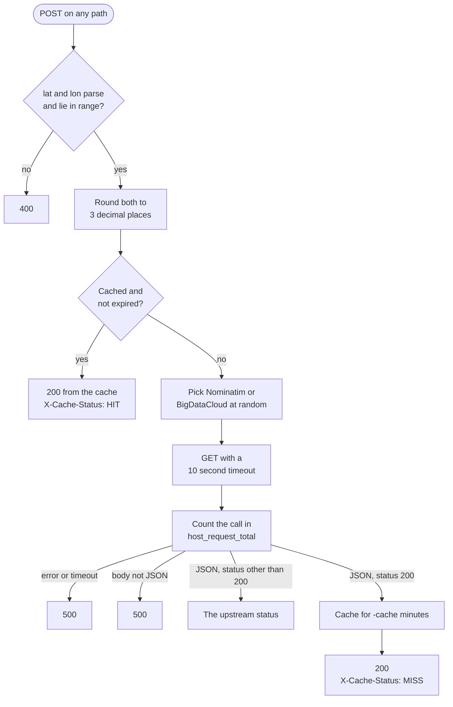

# Architecture

## Request handling

The HTTP server in [`geocode.go`](https://github.com/saidsef/faas-reverse-geocoding/blob/main/geocode.go) has two routes. `/metrics` goes to the Prometheus handler. `/` matches every other path and goes to the geocoding handler in [`latitude_longitude.go`](https://github.com/saidsef/faas-reverse-geocoding/blob/main/internal/handlers/latitude_longitude.go), behind a middleware that logs each request. [API](./api.md) lists what each method returns.

## Cache

The cache in [`cache.go`](https://github.com/saidsef/faas-reverse-geocoding/blob/main/internal/cache/cache.go) is a map held in the memory of each process. Its key is the latitude and longitude rounded to 3 decimal places, and its value is the decoded JSON from the provider. Only a lookup that returns status 200 goes into the cache, and it stays for the number of minutes `-cache` sets.

The cache has no size limit and no background cleanup. An expired entry leaves memory only when a later request reads its key, so memory grows with the number of distinct locations requested. A restart empties the cache.

Replicas do not share a cache. The Service in the Kustomize base sets `ClientIP` session affinity for 60 seconds, so repeat requests from one client within that time reach the same pod. The Service in the Helm chart sets no affinity.

## Upstream providers

Each cache miss picks one of the two providers with `crypto/rand` and sends it one request. The service does not retry, and does not fall back to the other provider when the first one fails. The HTTP client gives up after 10 seconds and sends Go's default `User-Agent`, `Go-http-client/1.1`.

Both providers publish terms of use:

- The [Nominatim usage policy](https://operations.osmfoundation.org/policies/nominatim/) allows at most one request a second and requires a `User-Agent` that identifies the application. It states that stock User-Agents as set by HTTP libraries do not qualify.
- BigDataCloud documents the [reverse geocode to city API](https://www.bigdatacloud.com/free-api/free-reverse-geocode-to-city-api) as client-side only. Its fair use policy treats server-side calls as a breach, and a breach can lead to a temporary IP ban, with the endpoint returning HTTP 402.

A 402, like any status other than 200, reaches the client as that status when its body is JSON, and as 500 when it is not. [Errors](./api.md#errors) lists the bodies.

## Timeouts

| Timeout | Value | Applies to |
|---------|-------|------------|
| `ReadHeaderTimeout` | 15 seconds | Reading the request headers |
| `ReadTimeout` | 15 seconds | Reading the whole request |
| `WriteTimeout` | 10 seconds | Writing the response, counted from the end of the request headers |
| `IdleTimeout` | 30 seconds | Keeping an idle keep-alive connection open |
| HTTP client `Timeout` | 10 seconds | The whole upstream request, body included |

## Logging

The service logs through logrus as JSON to standard output, at level `info`, or `debug` with `-verbose`. [Log output](./installation.md#log-output) shows the lines a request writes.
